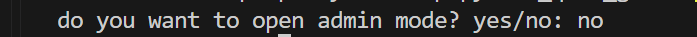
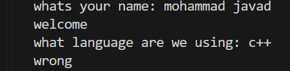
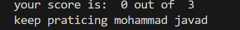
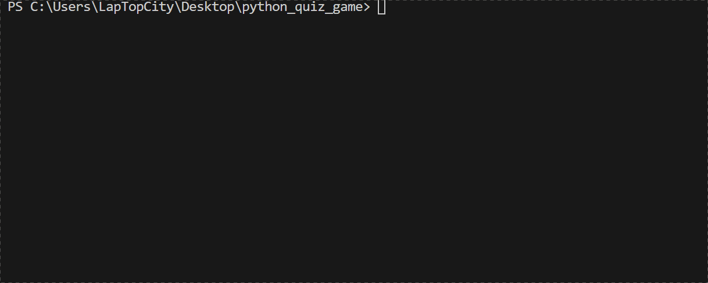

# Python Quiz Game


A simple quiz game built with Python.

## Table of Contents

* [Python Quiz Game](#python-quiz-game)

  * [Features](#features)
  * [Project Structure](#project-structure)
  * [File Description](#file-description)
  * [Requirements](#requirements)
  * [Installation](#installation)
  * [Environment Setup](#environment-setup)
  * [Usage](#usage)
  * [Example Output](#example-output)
  * [Screenshots](#screenshots)
  * [Demo](#demo)
  * [Roadmap](#roadmap)
  * [Contributing](#contributing)
  * [License](#license)
  * [Author](#author)

## Features

### Quiz System

* Asks the player multiple questions
* Checks the answers automatically
* Calculates the final score

### Result Storage

* Saves quiz results in `result.txt`

### Admin Mode

* Asks for the admin password
* Checks if the password is correct
* Keeps the password outside the main Python file
* Loads the password from `.env`

## Project Structure

```text
python_quiz_game/

│   .env.example
│   .gitignore
│   image.png
│   main.py
│   question.py
│   README.md
│   requirements.txt
│
├───gifs
│       quiz_demo.gif
│
└───pictures
        1.png
        2.png
        3.png
```

## File Description

| File                 | Description                                             |
| -------------------- | ------------------------------------------------------- |
| `main.py`            | Main file used to run the quiz game                     |
| `question.py`        | Stores questions and answers                            |
| `requirements.txt`   | Lists the Python packages needed for the project        |
| `.env.example`       | Shows the environment variables needed by the project   |
| `.gitignore`         | Tells Git which files and folders should not be tracked |
| `README.md`          | Contains the project documentation                      |
| `pictures/`          | Stores project screenshots                              |
| `pictures/1.png`     | Screenshot of the game start                            |
| `pictures/2.png`     | Screenshot of the quiz section                          |
| `pictures/3.png`     | Screenshot of the final result                          |
| `gifs/`              | Stores demo GIF files                                   |
| `gifs/quiz_demo.gif` | Shows the project demo                                  |

## Requirements

Before running the project, make sure you have:

* Python 3
* `python-dotenv`

## Installation

1. Open a terminal in the project folder.

2. Check that Python is installed:

```bash
python --version
```

3. Install the required packages:

```bash
pip install -r requirements.txt
```

## Environment Setup

1. Create a `.env` file from `.env.example`:

```bash
cp .env.example .env
```

2. Open the new `.env` file.

3. Replace the example value with your own password:

```text
QUIZ_ADMIN_PASSWORD=your_password_here
```

4. Save the file.

> Do not commit your `.env` file because it may contain private information.

## Usage

1. Open a terminal in the project folder.

2. Run the quiz game:

```bash
python main.py
```

3. Choose `yes` or `no` for admin mode.

4. If you choose `yes`, enter the password from your `.env` file.

5. Enter your name.

6. Answer the questions.

7. See your final score and message.

8. Your results are saved to `result.txt`.

## Example Output

```text
Do you want to open admin mode? yes/no: no

What's your name: Alex

Welcome!

What language are we using: c++

Wrong.

What command starts Git: git init

Correct!

What command shows Git status: git --oneline

Wrong.

Your score is: 1 out of 3

Keep practicing, Alex!
```

## Screenshots

### Start Game



### Quiz



### Final Score



## Demo



## Roadmap

- [x] Add multiple quiz questions
- [x] Calculate the final score
- [x] Save results to a file
- [x] Add admin mode
- [ ] Add more quiz questions
- [ ] Add difficulty levels
- [ ] Add a timer

## Contributing

Contributions are welcome!

## License

This project is licensed under the MIT License.

## Author

Created by [Hamidreza](https://github.com/hamidrezaesfandiary)
